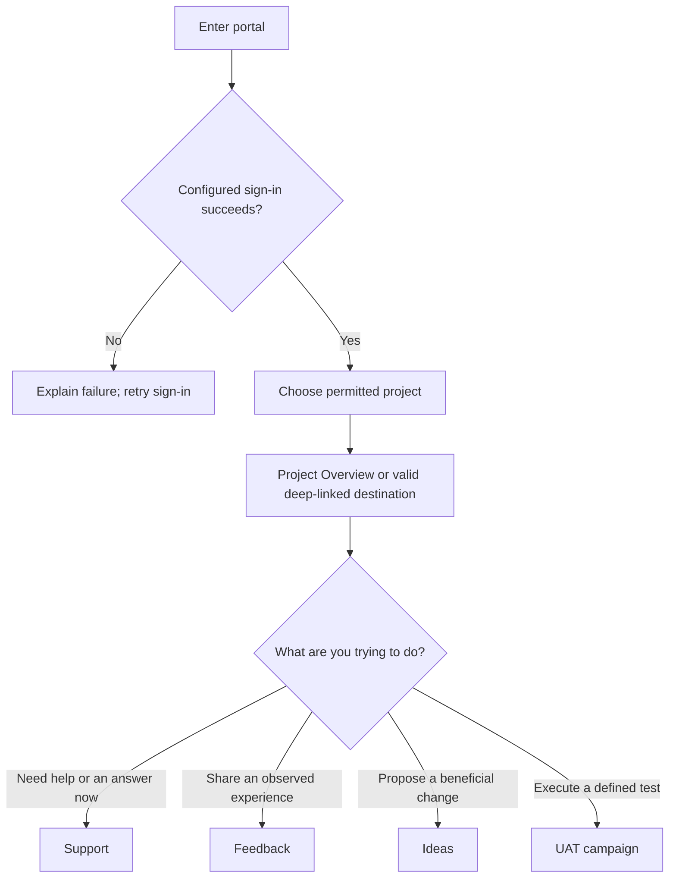
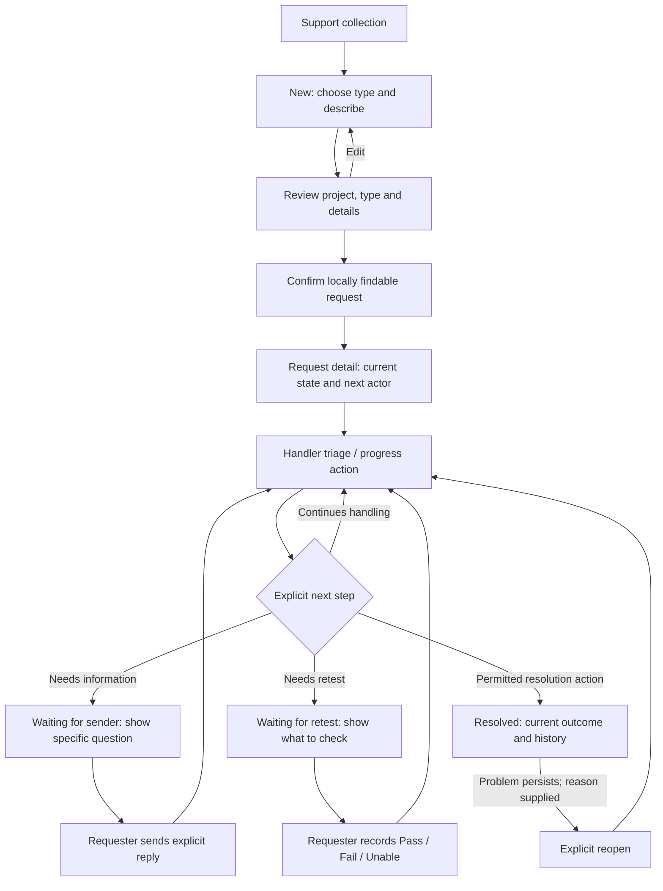

# DX Support: sitemap, user journeys and UI flows

Status: proposed design for evaluation  
Updated: 2026-10-30  
Basis: [Product design](product-design.md) and [Test plan](test-plan.md)  
Scope: information architecture and low-fidelity interaction design; no implementation or live-service approval

For the focused requester walkthrough, see [Support low-fidelity screens and walkthrough](support-wireframes.md). It provides text screen cards for the existing C2/C9 evaluation, not a working prototype.

## 1. Experience goal and boundaries

Help a user answer five questions throughout a task:

1. Am I in the correct project?
2. Is this the right place for what I need?
3. What was actually recorded?
4. Who acts next, and what can I do now?
5. How do I return, correct a mistake or continue if the outcome is not satisfactory?

A closed journey means a findable record, an understandable outcome and an explicit next step or recovery path. It does **not** mean every submission is resolved, approved or delivered. Waiting is a legitimate state when its meaning and next actor are clear.

This document makes the existing Shape proposal concrete enough for walkthroughs. It does not validate user needs, choose production permissions, authorize a build or replace the product design's module/lifecycle definitions. Screens, layouts and interactions below are proposals, not an inventory of working routes. Source observations in the product design remain a dated snapshot; current runtime behavior has not been checked here.

Use fictional data only. Proposed records and settings are same-session demo state, not durable storage. There are no live notifications, uploads, access grants or automatic cross-module conversions. Unknown service/security owners, audience policy and retention remain blockers for live use under U2/U7/U11. All actors below are task facets, not permission grants.

## 2. Sitemap and navigation

The tree describes destinations, not URL contracts. Detail and review can be pages or in-context views; evaluation should decide before route design.

```text
SSO entry / sign-in outcome
├── Sign-in failure → retry configured sign-in
└── Workspace Home: find and select a permitted project
    └── Project workspace [current project always visible]
        ├── Overview: choose intent and enter a module
        ├── Support
        │   ├── Collection: search, Open / Closed / Needs your action
        │   ├── New request → Describe → Review → Confirmation
        │   └── Request detail
        │       ├── Current state, next action and official outcome
        │       ├── Original request and intake evidence illustration
        │       ├── Discussion and activity history
        │       └── Explicit requester / handler actions in context
        ├── Feedback
        │   ├── Collection: search and disposition views
        │   ├── New feedback → Describe → Review → Confirmation
        │   └── Feedback detail: observation, disposition, reason, clarification
        ├── Ideas
        │   ├── Collection: search and existing idea views
        │   ├── New idea → Describe → Review → Confirmation
        │   └── Idea detail: problem, outcome, position and reason
        │       └── Optional local-demo interest toggle
        ├── UAT
        │   └── Seeded campaign: progress and scenario list
        │       ├── Scenario detail → Record result / Retest
        │       │   └── Scenario-linked defect entry when applicable
        │       └── Defect log → Defect detail / Review resolution evidence
        └── Project settings
            ├── Read-only project identity and setup gaps
            ├── Per-module demo responsibility references
            └── Review reference change → Apply or Cancel

Shared shell: project switcher · personal vi/en language control
Shared recovery: unavailable destination · known failure · uncertain outcome
```

### Navigation decisions

| Element | Proposed behavior | Reason / boundary |
| --- | --- | --- |
| Workspace Home | Project directory, not a global mixed-project work queue | Establish scope before intake. No tenant, membership or global admin implied. |
| Project Overview | Four intent entries; Support visually primary, others easy to find | Requester-first without hiding Feedback, Ideas or UAT. No analytics dashboard needed. |
| Project navigation | Overview, Support, Feedback, Ideas, UAT; Settings visually separate | Separate doing work from configuring references. |
| Project switcher | Preserve the module section only if the destination exists; show the destination project explicitly | Never carry a record identifier, filter-specific personal data or unsent text to another project. A detail view returns to the destination's collection, not a same-ID record. |
| Breadcrumb | Projects → Project → Module → Record or current step | Enable deliberate return without relying on browser history. |
| Back to collection | Return within the current project; preserve valid search/filter context during the session where available | A cleared filter must be visible rather than silently hiding the new record. No persistent preference implied. |
| Master data | Read-only registry/reference context where needed | No separate master-data CRUD console, people directory or workflow designer. |
| Role-specific actions | Separate requester and operator/reviewer action groups on the relevant record | No new staff console or client-side visibility-as-security assumption. Real eligibility needs policy and enforcement. |

Do not add top-level Chat, Notifications, Approvals, Roadmap or Administration destinations for this scope. Language is personal, not a project setting. Unknown or inaccessible destinations show a generic unavailable state without confirming hidden names, existence or participants.

## 3. Entry and intent selection



For a deep link, establish authenticated and permitted project/record context before showing content. No accessible projects means no task destination: explain that no project is available, without inventing a provisioning channel. Expired authentication must not show stale restricted content; unsent-text handling across reauthentication remains a security decision, not a promise of retention.

Suggested intent language for evaluation:

| Entry | Helper text | Expected outcome |
| --- | --- | --- |
| Get support | Something is broken, you have a question, or you need access | A request with a next action; an Access request does not grant access. |
| Share feedback | Tell us about an experience; you do not need help with a personal issue now | A recorded observation and reviewer disposition, not a fix promise. |
| Suggest an idea | Describe a problem and the benefit of a change | A recorded proposal, not an approved roadmap item. |
| Run UAT | Work through a defined campaign's scenarios | Scenario evidence and linked defects, not release approval. |

Allow correction before submission. Explain the destination and ask before transferring any safe shared description; do not silently map type-specific fields. The default recovery can be to remain and copy/re-enter fictional text deliberately. After submission, explain the correct intent and any separately agreed manual handoff; do not imply that a linked or converted record exists. If no handoff channel is known, say the handoff is not arranged.

## 4. Shared screen and interaction structure

### Collection

Order: project/module heading → purpose and primary action → search and views → records → empty/error state. Each record should expose its title, identifier if available, domain-specific state and next-action cue where meaningful. Use timestamps only if actually known. Search is scoped to the displayed module and project; it is not global search.

- Empty collection: explain what belongs here and offer the module's allowed first action. UAT offers seeded campaign context, not campaign creation.
- No search matches: retain the query, show applied filters and offer Clear filters. Do not present this as an empty project.
- Loading: keep the project/module identity visible, avoid briefly showing another project's rows.
- Known load failure: explain the affected area and offer safe retry. Do not substitute another project's fixtures.

### Describe → Review → Confirmation

1. **Describe:** show current project, purpose, demo/reset limit and sensitive-data warning before entry. Ask only for the selected module/type's information. Reuse source-defined fields; this document adds no new mandatory intake fields.
2. **Validate:** identify the field and explain the correction; keep valid input. Show an error summary with links to affected fields for longer forms.
3. **Review:** show project, type/intent and entered information. Provide Back to edit. Changing a type must make removed/incompatible answers visible for review rather than silently repurposing them.
4. **Confirm:** use a domain-specific submission action. Disable repeat activation only while processing; do not imply duplicate prevention beyond verified behavior.
5. **Confirmation:** only after the record is visible in the same session, show what was recorded, the reset limit, next actor and **View record** as the primary action. Return to collection is secondary. An ID or toast alone is not sufficient.

Confirmation is a wayfinding step, not a dead end. View record must lead to the recorded content in the current project; a later collection return must make the new record findable, even if previous filters would exclude it. Explain any filter reset.

### Record detail: proposed reading order

```text
Breadcrumb and current project
Title · identifier · domain-specific state
Next action summary: who acts / what is needed / relevant primary action
Current official outcome or disposition, if one exists
Original submission or scenario context
Discussion / clarification / evidence in the module's own scope
Activity and prior outcomes, with superseded outcomes identified
Relevant secondary actions and return to collection
```

This is a reading hierarchy, not a mandated tab layout. On narrow screens use one column: do not bury the next action below a long history. Separate the ordinary message composer from workflow controls. Show the audience and local-save limits near the composer, with no internal-note toggle. Keep history readable in a stable, labelled order; never invent missing authors or times.

## 5. End-to-end journey map

| Journey / actors | Start and main stages | Handoff and return | Meaningful closure / recovery | Product links |
| --- | --- | --- | --- | --- |
| Get support — requester, handler | Correct project → type → describe → review → confirm → detail | Requester returns through collection/detail; handler explains progress or asks for an explicit response | Current outcome is understandable; unresolved work still has a next actor. Retest/reopen stay available when applicable. | ACT-02/03; UC-04–10, 27–29; N1–4, N12–13 |
| Share experience — contributor, reviewer | Observation/context → review → confirm → findable detail | Reviewer records disposition/reason; contributor answers clarification in the same record | Reviewer records the next disposition with explanation. “Noted” does not promise a change. | ACT-04/05; UC-11–13; N5–6 |
| Propose improvement — contributor/supporter, reviewer | Inspect existing ideas → describe problem/outcome → review → confirm → detail | Reviewer explains position and next-review expectation; return via Ideas collection | Recorded proposal and intelligible position. No date is invented when review timing is unknown. Interest is not approval. | ACT-06/07; UC-14–16; N5–6 |
| Complete test evidence — tester, coordinator | Campaign → scenario instructions → execute → record result/note | Fail/Blocked can produce a scenario-linked defect; fix evidence leads to explicit retest | Evidence remains inspectable; defect resolution requires linked Pass and a permitted explicit action. No release acceptance. | ACT-08/09; UC-17–20; N3–5 |
| Review setup — maintainer | Project settings → inspect identity, source and missing references → edit harmless local reference | Review old/new values and scope → Apply → revisit reflected local value | No assignment, duty or permission changes. Cancel/validation failure do not lose the last recorded local value. | ACT-10; UC-21/22; N7–10 |

Common navigation, locale and unavailable paths cover ACT-01/15 and UC-01–03. ACT-11–14 and UC-23–26 remain external governance/engineering handoffs, not extra product screens. A referenced engineer or owner does not receive a notification or acquire access. An external investigation can return evidence for an explicit handler action; it never auto-resolves the record.

## 6. Support UI flow and handoff rules



This is a navigation/handoff diagram, not a replacement state machine. Duplicate, workaround, misroute and engineering-reference actions retain their own defined effects; the UI must not assume each resolves the request. Handler ownership/priority/resolution screens are proposed where the source only exposes model vocabulary.

| Detail context | Main requester experience | Effect / handler responsibility |
| --- | --- | --- |
| Handling | Read progress and next actor; optionally Add update | Ordinary update adds context only; it does not assign, escalate or change workflow. |
| Waiting for sender | Show the specific question and **Send requested information** | Explicit reply returns the next action to handler. A generic comment must not appear to satisfy the request. |
| Waiting for retest | Show instructions and **Record retest result** | Use Support Pass/Fail/Unable with applicable notes. Return result to handler; do not auto-resolve, including on Pass. |
| Resolved | Show current official outcome, previous outcomes and **Reopen request** | Discussion is read-only until explicit reopening with a reason. Keep prior outcome, marked superseded when applicable. |
| Reopened | Explain that the former outcome no longer represents the current resolution | Handler acts next; show new reason and preserved history. |

Handler flow: inspect intake/history → choose a specific action → provide required explanation → review effect and next actor → apply → see the resulting state/activity in the same detail. Cancel returns to the unchanged record. A plain participant-visible handler response is not a request-info action. Labels, outcome and next-actor summary must agree after every explicit action.

No notifications are promised: follow-up means returning to the module's collection and opening the request. Needs your action is a proposed view, not an inbox delivery guarantee. Resolved can be a legitimate stopping point; do not force an extra acceptance step or satisfaction survey to “complete” the journey.

## 7. Other module UI flows

### Feedback: observe → record → understand review

Collection → New feedback → observation/context → Review → Confirm → View feedback. The detail initially explains **Not reviewed** and the reviewer next action. Reviewer chooses a disposition with its required reason/next-step explanation and sees the reflected result. Contributor returns through the collection.

If **Needs clarification**, show the reviewer's question with an explicit Answer clarification action. Preserve the answer in the same record and make reviewer follow-up clear. A reply is not automatically Acknowledged or Noted: the reviewer chooses the subsequent disposition. No Support status enum or automatic conversion is introduced. **Acknowledged** means received/recognized, not delivery commitment; **Noted** is a disposition, not evidence of an implemented change.

### Ideas: discover → propose → understand position

Collection search → inspect an existing idea, or New idea → problem/outcome with optional suggestion/sponsor → Review → Confirm → View idea. Sponsor text neither provisions an account nor notifies a person. Detail shows recorded content and the existing position's meaning.

Reviewer action is proposed: explain position, reason and what happens next, including unknown review timing. Keep fixture position semantics; do not invent an approval pipeline. Optional interest toggle stays secondary and explicitly local-demo-only while vote intent U4 is unresolved. No comments, notification, ranking or delivery promise is added. A user who finds an adequate existing idea can stop after reading or expressing local interest without creating a duplicate.

### UAT: execute → capture evidence → retest → inspect outcome

Campaign → Scenario → read instructions → execute outside the form as appropriate → select Not run/Pass/Fail/Blocked and supply applicable source-defined notes → inspect reflected evidence. Fail/Blocked exposes the scenario-linked defect path; if no defect is recorded, make that fact visible rather than claiming a complete defect report.

Defect log → linked scenario/evidence → explicit retesting action when applicable → tester records a new scenario result → coordinator reviews evidence. A linked Pass makes resolution eligible; it does not silently resolve the defect. Fail/Blocked stays unresolved. Keep earlier defect context and readable scenario evidence; do not claim an unimplemented immutable result-version history. Use scenario result, defect state and campaign progress as separate labels. No Support Unable result, campaign builder or release-approval action belongs here.

### Settings: inspect → edit reference → review effect → apply

Settings → verify project/read-only source → inspect missing references → edit one harmless fictional responsibility reference → Review old/new value, source and project scope → Apply or Cancel. Only confirm Apply once the value is actually reflected and revisitable in the same session. Show that it changes a displayed reference only, not duty, access, routing, notifications or active/new work assignment. Registry identity and governed taxonomies remain read-only; archive/delete/merge stay unavailable. No “Ready” badge follows from a nonempty name.

## 8. Recovery and edge-state contract

| Situation | UI response | Exit / closure |
| --- | --- | --- |
| Validation error | Explain what is wrong next to the field; preserve valid input and provide error navigation | Correct → review again; no false success. |
| Back from review | Restore the entered values within the active flow | Edit → review updated summary. No durable draft implied. |
| Leave with unsent input, including project switch | Offer Stay or Discard and leave before navigation; identify the destination | Stay keeps the current flow; discard intentionally loses input. Never transplant it to another record/project. No browser/reload persistence promise. |
| Known submission failure | Keep input where still available; state the known failure and offer retry only if safe | Retry or cancel; do not manufacture a record ID. |
| Submission outcome uncertain | State uncertainty; offer inspection of the current record/history or collection when determinable | If visible, continue there. Otherwise stop and keep uncertainty explicit; do not encourage blind duplicate submission or claim deduplication. |
| Record not visible under filters | Expose scope and filters; offer appropriate filter reset | Find the record in its actual project; do not search inaccessible projects or fabricate a match. |
| Unknown/inaccessible project or record | Generic unavailable state, no hidden metadata | Return to a permitted collection or project directory. No silent fallback record. |
| Demo reset/reload loses local records | Explain reset limits before input and confirmation; on return do not imply durable recovery | Re-enter fictional content only if the reset outcome is known. No autosave/draft recovery claim. |
| Resolved request needs more work | Show Reopen with required reason, separate from discussion | New handler action; previous outcome remains readable. |
| Mistaken posted discussion text | Add a correction on an active permitted request | No silent edit/delete; resolved work requires reopen. Sensitive-data disclosure is not solved by this path—stop and use approved handling once established. |
| Personal language change fails | Preserve project/record context and report the failed preference change | Continue in the known language or retry safely; do not claim that translation or saving succeeded. |

## 9. Accessibility, language and content rules

- Use visible labels, meaningful headings, keyboard-operable controls and a logical focus order. Do not communicate state or required action with color alone.
- On step navigation, move focus to the step heading; on validation, focus the error summary or first relevant error. Announce processing and confirmed outcomes without relying only on transient toasts. Actual behavior needs implementation testing.
- Ensure next-action controls and errors remain readable on mobile and at enlarged text sizes. Avoid a fixed action bar that covers content or keyboard focus.
- Keep ordinary discussion, explicit reply, retest, reopen and resolve labels distinct. Use one main next-action cue for the current task; secondary actions remain discoverable.
- Proposed user-facing term is **requester**, while existing technical `Sender` and lifecycle vocabulary remain unchanged. Translate meaning consistently across vi/en, not just navigation labels.
- Review Vietnamese/English forms, help, validation, empty states, confirmation, history and outcomes together. This English draft is not approved translation or an accessibility-conformance claim.
- Prefer honest outcome copy such as “Recorded in this demo session; resetting the demo removes local changes.” Avoid “We notified the team”, “Saved permanently”, “Access approved” or promised review dates without evidence.

## 10. Evaluation coverage and next design decisions

Reuse the existing planned cases rather than treating this document as tested design:

| Existing case | Walkthrough material from this document | Observe before explaining |
| --- | --- | --- |
| C1 | Sitemap and intent entries, including wrong-entry correction | Chosen destination and expected outcome; do not give tasks their expected module names. |
| C2 | Support intake, review correction, confirmation, return and explicit follow-up | Project/type understanding, findability expectation and next actor. Record intake and follow-up separately. |
| C3 | Feedback/Ideas create → detail → collection → revisit | Whether the person can explain what was recorded and what review does not promise. |
| C4 | Screen hierarchy, error/recovery and language rules | Content comprehension; keyboard/focus/mobile behavior only when an implementation exists. |
| C5 | External handoffs, audience and settings boundaries | Attributed owner/policy decisions; a successful walkthrough cannot supply authority. |
| C6/C7 | Project switching and reference-change review | Scope, local value versus durable state, and reference versus assignment/access effects. |
| C8 | Journey handoffs and task facets | Actual tasks/overlaps before introducing the proposed actor roster. |
| C9 | Support detail, composer and explicit action distinctions | Whether a comment is mistaken for reply, resolution, reopen, delivery or private messaging. |

Keep the first pilot focused on C2 and relevant C9 material, with short C1/C4 content only where appropriate. Foundation/authority rounds remain separate; this broader flow map does not authorize module expansion. All cases remain planned/not run.

Open decisions before detailed implementation: actual service and security owners; permitted audience/action rules; real user task evidence; reviewed vi/en content and access needs; confirmation of state effects where handler UI is incomplete; whether screen sections need separate routes; and whether flat history plus clearer labels is sufficient. Evaluate these flows before investing in high-fidelity screens. A later prototype must separately demonstrate navigation, input retention, same-session recording, filter recovery and keyboard behavior; prose cannot prove them.
